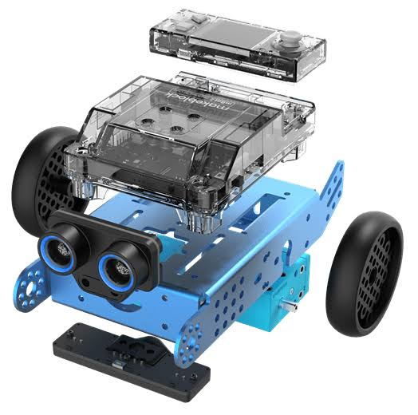
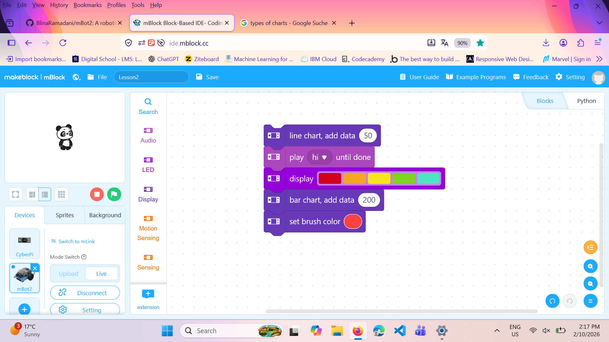

# mBot2
A robotics project developed with mBot2, focusing on programming, sensors, and autonomous control.
## mBot2 projects created with programming languages:Python and Scratch

##mBot2 Parts

#First Project
import cyberpi
import time

# cyberpi.console.print("Blina Ramadani")
# #Ciberpi.console.print eshte per te printuar
# cyberpi.console.print("Linux Lab")
# cyberpi.console.print("Grade 12")
# cyberpi.console.clear()
# cyberpi.console.println("Grade 12")
# cyberpi.console.println("Linux Lab")

# cyberpi.led.on(255,0,0) #Red
# cyberpi.led.on(0,255,0) #Green
# cyberpi.led.on(0,0,255) #Blue
# #RGB(Red, Green,Blue) 0-255 = 256
# cyberpi.led.off()

# cyberpi.led.show("r g b y p")
# cyberpi.led.show("b p r g y")
# cyberpi.led.on("red")

#Make a traffic-light
cyberpi.console.println("RED:STOP")
cyberpi.led.on("red")
time.sleep(3)

cyberpi.console.println("YELLOW:WAIT")
cyberpi.led.on("yellow")
time.sleep(3)

cyberpi.console.println("GREEN:GO")
cyberpi.led.on("green")
time.sleep(3)
cyberpi.led.off()
